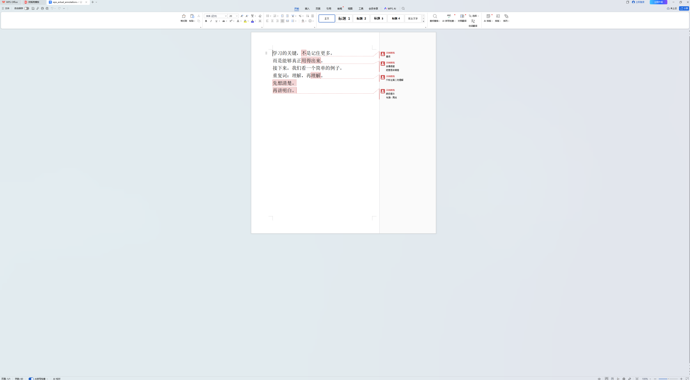

# 朗读批注使用说明

朗读批注用于提醒主播怎样读某个字词，例如重读、停顿、放慢或语气上扬。先选中需要提醒的原文，再写提示；批注会跟随对应字词显示，不加入朗读正文。

可以直接在提词器里添加，也可以导入已经写好批注的文档。

## 一、直接给稿件添加批注

1. 打开稿件，进入编辑页面。
2. 在正文里拖动选中需要提醒的字、词或短语。
3. 点击工具栏中的“添加批注”。
4. 在“朗读批注”窗口填写提示，也可以点击“重读”“停一秒”“放慢语速”“语气上扬”等快捷提示。
5. 查看下方的“实时局部预览”，确认标记对应的是所选字词，再点击“保存批注”。
6. 离开稿件前，确认保存状态。

例如，原文是“知识需要节奏，知识需要停顿。”，只想提醒第二个“知识”重读，就只选中第二个“知识”。不需要选中整句；相同的词出现在其他位置，也不会因此同时加上这条批注。

建议每条提示表达一个动作，例如“停一秒”或“‘需要’重读”。需要保留教学说明时，也可以填写完整说明；画面中的简短展示不会删除备注全文。

### 查看和修改实时预览

填写批注时，局部预览会随输入更新，用来检查当前字词与这条提示的对应关系。

保存后，编辑页面会显示批注预览区域。点击预览区域上方的批注条目，可以切换要检查的批注并定位原文；点击预览中的原文字词框或备注，可以修改该条内容。窗口较窄时，预览会调整到编辑区下方；高度不足时，可通过下方的查看按钮打开局部预览。

工具栏中的“显示或收起批注预览”用于调整编辑页面的预览区域。正式开播前，再进入提词页面，结合实际字号、行距和窗口宽度检查整体效果。

## 二、导入文档里的批注

### 文字文档

1. 在 Word（文字处理软件）或 WPS（办公软件）中，选中需要提示的原文字词，再添加批注。
2. 填写停顿、重音或语气说明，保存为 `.docx`（文字文档格式）文件。
3. 回到提词器主页，选择“导入文件”，选择该文件；也可以把文件拖入桌面窗口。
4. 阅读导入结果，打开新稿件检查批注和原文字词的对应关系。

只有光标位置、没有明确选中文字的批注会进入“待定位”，需要在提词器中手动绑定。旧式 `.doc`（早期文字文档格式）文件需要先在原软件中另存为当前支持的文字文档格式。

### PDF（便携式文档格式）文件

在原软件中，使用文字批注工具选中原文，再添加高亮、下划线、波浪下划线或删除线，并填写说明文字。保存文件后，通过主页“导入文件”导入，也可以拖入桌面窗口。

不同批注的处理方式如下：

| 原文件中的批注 | 导入后的处理 |
| --- | --- |
| 选中文字后添加的高亮、下划线、波浪下划线或删除线，并带有说明文字 | 能确认原文范围时，批注绑定到对应字词 |
| 同一条批注选中了几处不相连的文字 | 分别保留这些选区，中间没有选中的字词不会被一并标记 |
| 对已有文字批注的回复 | 能确认其所属批注时，沿用该批注对应的原文范围 |
| 便笺、自由文本框、箭头，或无法确认文字选区的批注 | 保留说明文字，列为“待定位”，供手动绑定 |
| 只有颜色或线条、没有说明文字的标记 | 不生成空白朗读提示；导入结果会提示处理情况 |

批注标记与文字层必须在原文件中保留下来。如果备注已被合并成页面图片或普通页面内容，就无法恢复为独立批注。复杂多栏、表格和特殊排版文件导入后，需要检查正文阅读顺序。

### 扫描页、加密文件与提取限制

- 整份文件只有扫描图片、没有可提取的文字时，不会生成空稿。请先在原软件中完成文字识别，保存带有文字层的文件，再导入。
- 文件同时有文字页和扫描页时，导入可读取的正文，并在导入结果中说明没有文字层的页面。能读取到的扫描页备注会保留，不能确认原文字词时列为“待定位”。
- 文件需要密码、禁止文字提取或已损坏时，会显示对应提示。请先在原软件中确认文件和权限，再另存为能够正常打开且允许提取文字的版本。

## 三、处理“待定位”批注

“待定位”表示备注内容已保留，但当前不能确认它对应哪一段原文。它不会自动贴到另一个同名词上。

手动绑定的方法：

1. 关闭批注管理窗口，回到正文。
2. 选中这条批注应该对应的字词。
3. 打开工具栏中的“批注管理”。
4. 确认窗口顶部显示的“当前选中”文字。
5. 找到目标备注，点击“绑定到所选字词”。
6. 回到预览或提词页面检查对应关系。

“批注管理”中可以查看完整备注、定位已绑定的原文、编辑内容和删除批注。重新绑定会把该条批注的范围改为当前选中的字词。

正文修改后，软件会重新检查对应关系。无法确认的批注会转为待定位；备注文字仍保留，重新选择原文后即可绑定。

使用编辑器的“撤销”“重做”恢复正文时，批注会跟随相应的编辑记录恢复位置；已经修改的备注内容会保留，已经删除的批注不会重新出现。

## 四、提词时查看、隐藏批注

进入提词页面后，已绑定的原文字词会显示标记，提示文字显示在附近留白，并通过引线对应原文。原文自动折行时，标记跟随实际字词分段显示。

较长的备注会在提词画面中省略部分文字，全文仍保留。点击可见的备注文字，或长按、右键点击原文字词框，可以查看完整内容。留白不足、提示文字没有展开时，也可以通过字词框查看。

顶部控制栏的“批注：开”可以一键切换为“批注：关”，再次点击恢复显示。隐藏批注不会删除备注，也不会改变正文的换行、位置和滚动进度。熟练主播可以关闭提示，练习时再开启。

编辑页面的“收起预览”和提词页面的“批注：开／关”是两个不同操作：前者调整编辑界面，后者控制提词画面中的批注显示。

批注文字不属于朗读正文，语音跟读按稿件正文推进。导入后在提词器内编辑的批注保存在稿件中，不会回写原来的办公文档。

## 五、真实文档示例

下图是在实际 WPS（办公软件）窗口中打开的示例文档，展示导入前的原文字词范围和四条备注。选区包括单字“不”、短语“用得出来”、重复出现的第二处“理解”，以及跨段文字“先想清楚。再讲明白。”。

[查看完整原始截图](screenshots/wps-real-comments.png)。此图展示原文档中的批注；进入提词器后，可通过实时局部预览查看朗读时的显示效果。
